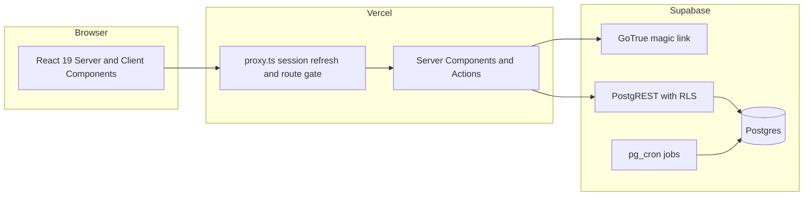

# Chairside

Booking software for independent salons and barbershops. Multi-tenant, with
online booking, staff rosters, turnaround-aware availability, and card deposits.

Built as a portfolio project, but modelled on the real constraints of a small
shop: one owner, a couple of stylists, a shared chair, and customers who book
from a phone that may be in another timezone.

## What makes it interesting

Most booking demos stop at CRUD. The hard parts here are elsewhere:

| Problem | How it is handled |
| --- | --- |
| Availability must be correct across daylight saving | Opening hours stored as local wall-clock minutes, converted to instants in one place, with nonexistent times skipped |
| Two people tapping the same slot must not both succeed | Postgres `EXCLUDE USING gist` on the occupied range, not just an application check |
| Clean-up time is real | Turnaround is owed by the appointment that just happened, stored as a generated `tstzrange` |
| Tenants must not see each other's data | RLS on every table, with `SECURITY DEFINER` helpers to avoid policy recursion |
| Payments arrive out of order or twice | Webhook handling is a later phase; the schema already snapshots price per booking |

## Architecture



Three Supabase clients exist, and the distinction matters:

- `src/lib/supabase/client.ts` — browser, anon key, RLS enforced.
- `src/lib/supabase/server.ts` — request-scoped cookies, anon key, RLS enforced.
- `src/lib/supabase/admin.ts` — service role, bypasses RLS. Only for code paths
  that authenticate some other way (public booking endpoint, verified webhooks).

## Scheduling model

`generateSlots()` in [`src/lib/scheduling/slots.ts`](src/lib/scheduling/slots.ts)
is deliberately pure: no database, no clock, no network. `now` is injected, so
every DST edge case is a unit test rather than a production surprise.

Two ideas do the heavy lifting:

1. **Opening hours are wall-clock, bookings are instants.** "We open at 9" must
   stay 9 when the clocks change. Slots are rendered into instants only at the
   end, which localises all timezone handling.
2. **A busy interval is not a point.** An appointment occupies its duration plus
   the turnaround it owes. That is why `bufferAfterMinutes` lives on the busy
   interval, not on the candidate — see
   [ADR 0001](docs/adr/0001-scheduling-model.md).

## Running locally

Requirements: Node 22+, npm 11+.

New to the three-service setup? Read [docs/setup.md](docs/setup.md) first — it
explains what belongs in GitHub versus Supabase, which keys are secret, and why
`.env.local` is never committed.

```bash
npm install
cp .env.example .env.local   # fill in your Supabase project values
npx supabase link --project-ref <your-project-ref>
npx supabase db push         # applies supabase/migrations to your project
npm run dev
```

Magic links also require your redirect URLs to be registered in Supabase under
**Authentication → URL Configuration**. See [docs/setup.md](docs/setup.md).

Verification:

```bash
npm run verify   # typecheck, lint, unit tests
npm run build
```

### Database

Schema lives in version control:

```text
supabase/migrations/20261021000000_init_schema.sql
supabase/seed.sql
```

With Docker installed:

```bash
npm run db:start
npm run db:reset    # applies migrations and seed data
npm run db:stop
```

Without Docker, apply the migration to a hosted Supabase project instead:

```bash
npm run db:push
```

`db:reset` also runs `supabase/seed.sql`, which creates a demo shop
("Fade & Co.") with two stylists, four services, Tuesday-to-Saturday opening
hours, and one existing booking so the double-booking path can be demonstrated.

## Schema notes worth reading

- `appointments.occupied_range` is a **generated** column, so it can never drift
  from `starts_at`, `ends_at` and `buffer_minutes`.
- The exclusion constraint is partial (`where status in (...)`) so cancelling
  and marking a no-show genuinely releases the chair.
- `organization_members` policies call `is_org_member()`, a `SECURITY DEFINER`
  function. A policy that queried `organization_members` inline would recurse.
- Anonymous visitors can read active services, staff, and availability — nothing
  else. Customer names and phone numbers are never exposed to `anon`.

## Status

Phase 1 (scaffold) is complete:

- [x] Next.js 16 App Router, TypeScript strict, Tailwind v4
- [x] Magic-link auth with server-side token exchange
- [x] Session refresh and route gating in `proxy.ts`
- [x] Tenancy schema, RLS, and seed data
- [x] Timezone-correct slot engine with 17 unit tests
- [x] CI-ready `verify` script

Next: staff CRUD, public booking page, Stripe deposits, reminders. See the
project todo list for the full sequence.

## Licence

MIT
